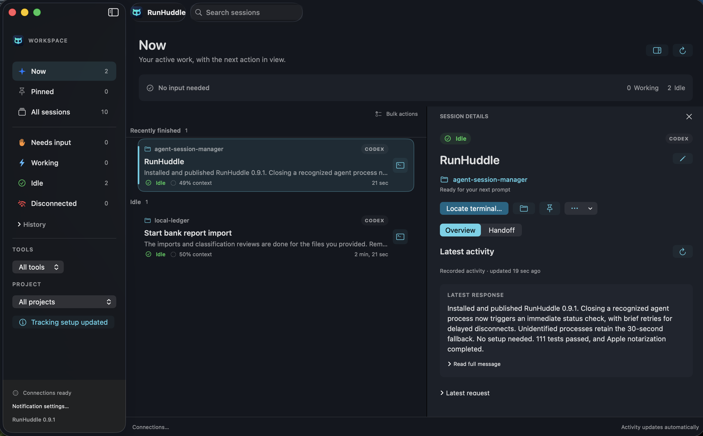
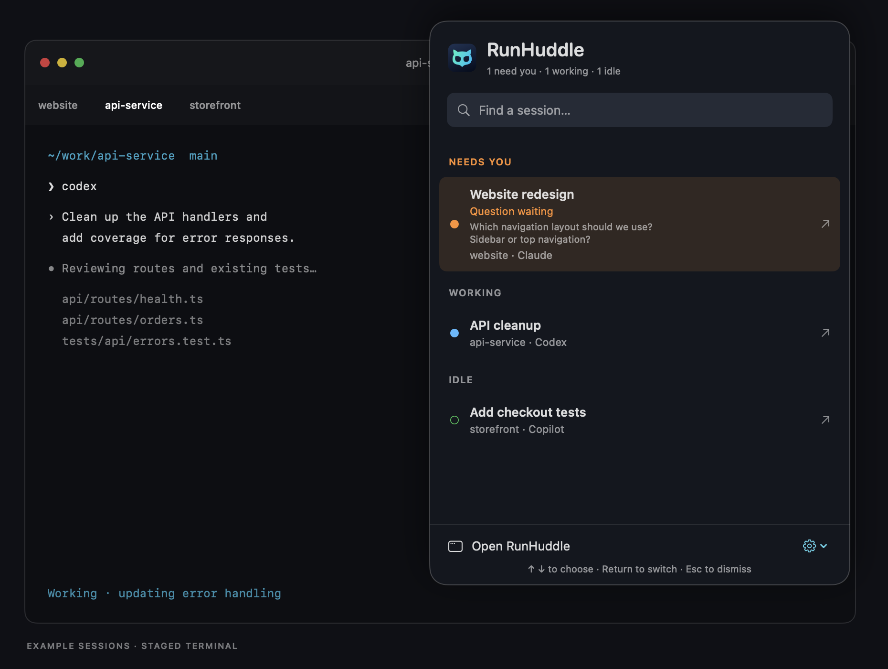

# RunHuddle

**Your coding agents, together.** A native macOS app by [Rootsignal](https://rootsignal.io) for finding, monitoring, and returning to AI coding sessions across local projects.

## Download

**[Download RunHuddle](https://github.com/rootsignal/runhuddle/releases)** · [Getting started](docs/GETTING_STARTED.md)

Requires **macOS 14 or newer on Apple Silicon**. Open the `.dmg`, drag RunHuddle to Applications, and launch it. No Python, Swift, or source checkout required. Your agent CLIs and accounts are installed separately.

RunHuddle is an early preview, distributed directly with Developer ID signing and Apple notarization.

## What it does

- See which sessions need input, are working, or are idle.
- Switch to a session’s terminal from the menu bar or with **Control–Option–Space**. Customize the shortcut in Settings.
- Find sessions by project, title, or recorded conversation history.
- Resume saved conversations and generate AI handoffs when you’re ready for a fresh session.
- Pin important sessions and clean up old ones with bulk actions.

## Stay in your terminal

Press **Control–Option–Space** or click the menu-bar owl to see who needs you and jump to a session’s terminal.

*Example sessions in the actual RunHuddle interface, shown over a staged terminal.*

## Supported agents

**Codex CLI, Claude Code, and GitHub Copilot CLI**, with terminal navigation for **Terminal.app, Ghostty, and iTerm2**, plus attached tmux panes. Support and validation vary by integration; see [Agent connections](docs/AGENT_CONNECTIONS.md) for compatibility details.

## Documentation

- [Getting started](docs/GETTING_STARTED.md) — install, update, and uninstall
- [Using RunHuddle](docs/USING_RUNHUDDLE.md) — switcher, search, status, handoffs, and cleanup
- [Agent connections](docs/AGENT_CONNECTIONS.md) — setup and supported integrations
- [Troubleshooting](docs/TROUBLESHOOTING.md) — common problems and fixes
- [Building and testing](docs/BUILDING.md) · [Publishing releases](docs/RELEASING.md)

[All documentation](docs/README.md) · [Release notes](docs/releases/) · [Report an issue](https://github.com/rootsignal/runhuddle/issues)

Copyright © 2026 Rootsignal. All rights reserved. No open-source license has been selected for this repository.
